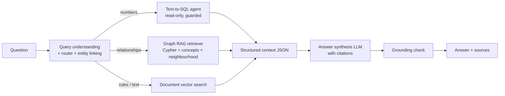

# Graph RAG Based Intelligent HR Assistant

**AI-Based Integrated HR Management and Workforce Decision Support**

An HR assistant that answers plain-English questions about a company's workforce by combining
**structured HR data** (PostgreSQL), a **knowledge graph** (Neo4j) and **HR documents**
(policies, performance reviews, project reports, resumes) using **Graph RAG**.

Ask things like:

- *"How many active employees does each department have?"* (database)
- *"Which projects are running into problems with an external vendor's API, and who leads them?"* (knowledge graph)
- *"How many days of paternity leave do employees get, and is it paid?"* (documents)
- *"Is Arya Zachariah eligible for promotion under our appraisal policy?"* (database + documents)
- *"Who mentors people in the Data Science team, and how are their mentees performing?"* (graph + database)

Every answer cites its sources (`[SQL]`, `[Graph]`, `[Doc: id]`) and is checked against the retrieved
data before it is shown.

---

## Why Graph RAG?

Plain RAG (vector search over text chunks) finds passages that *sound* similar to the question.
It struggles when the answer needs **relationships** spread across many documents, such as
"who mentors whom" or "which projects share the same risk". It also can't do **exact numbers**
like averages, counts and payroll totals.

This project combines three kinds of retrieval:

| Need | Source | Technique |
|---|---|---|
| Exact numbers (headcount, ratings, payroll, attendance) | PostgreSQL | Text-to-SQL with guardrails |
| Relationships (mentoring, collaboration, soft skills, risks, recommendations) | Neo4j knowledge graph | Text-to-Cypher + entity anchors + concept vector search + neighbourhood facts |
| Rules and descriptions (policies, reviews, reports) | Document chunks | Vector search filtered by document class |

A **router** decides which sources each question needs. The answer is written only from what
was retrieved, then a **grounding check** verifies that every number and name in it appears in the
retrieved data.

---

## Architecture



**How the knowledge graph is built**

1. Structured HR records (employees, departments, projects, skills, trainings, candidates) go into Neo4j as nodes and relationships.
2. An LLM reads each document and extracts facts as triples with a strict JSON schema, e.g. `(Priya, MENTORS, Rahul)`, `(Project X, HAS_RISK, third-party API delays)`.
3. Entity resolution links extracted names to existing graph nodes, so there are no duplicate people.
4. Document chunks and graph concepts are embedded (BAAI/bge-small-en-v1.5, 384-d) into Neo4j vector indexes.

---

## Features

**Web app (React + FastAPI)**
- **Ask the assistant:** chat with the full pipeline. Each answer shows route badges, confidence and grounding %, plus *"How this answer was found"* (generated SQL and rows, Cypher and a mini graph, source documents, timings).
- **Workforce dashboard:** live KPIs and charts (headcount, ratings, payroll, attendance, hiring pipeline) and an "employees to watch" list. No LLM, so it uses no API quota.
- **Employee profile:** database facts next to graph insights extracted from documents (mentoring, soft skills, recommendations), with the person's own graph.
- **Knowledge graph explorer:** search any person, project, skill or risk and click through the graph node by node.

**Safety guardrails**
- SQL: single `SELECT` only, keyword blocklist, read-only database user, read-only transaction, 10 s timeout, 200-row cap, and automatic self-repair on errors.
- Cypher: runs in Neo4j **READ** routing mode, so the database itself rejects writes.
- The model is told which facts a source does *not* contain (e.g. "a manager is not a mentor"), so it says "not answerable" instead of guessing.

---

## Results

| Component | Metric | Result |
|---|---|---|
| Triple extraction | documents processed / facts loaded | 37/37 docs, 349/350 triples |
| Query router | routing accuracy (test set) | 96% |
| Text-to-SQL agent | execution accuracy | 92% (guardrail tests 4/4) |
| Graph RAG retriever | F1 on 10 gold questions | 1.00 (10/10) |
| End-to-end pipeline | demo questions grounded | 5/5 at 100% |

Ground truth is computed directly from the raw data (`data/ground_truth`), not typed by hand.

---

## Tech stack

| Layer | Tools |
|---|---|
| Language | Python 3.10+, JavaScript |
| Relational DB | PostgreSQL on **Neon** (psycopg 3) |
| Graph DB | **Neo4j AuraDB Free** (vector + full-text indexes) |
| LLM | **Groq**: `openai/gpt-oss-120b`, fallback `openai/gpt-oss-20b` (strict JSON schema outputs) |
| Embeddings | **FastEmbed** `BAAI/bge-small-en-v1.5` (runs locally) |
| API | **FastAPI** + Uvicorn |
| Frontend | **React 18** + Vite, Recharts, vis-network |
| Data | Synthetic company "Nexora Technologies" generated with Faker (`en_IN`, seed 42) |

---

## Project structure

hr-graphrag/
data/
raw/ 12 CSV tables (employees, payroll, attendance, reviews, ...)
docs/ policies, performance reviews, project reports, resumes
extracted/ cached LLM triple extractions (one JSON per document)
ground_truth/ answers computed from raw data, used for evaluation
src/
config.py settings from .env
llm.py Groq wrapper (strict JSON, rate limits, fallback model)
embeddings.py FastEmbed helpers
check_connections.py tests Neon, Neo4j and Groq
data_gen/ synthetic data generator
db/ schema, loader, read-only user, checks
graph/ graph build, LLM extraction, entity resolution, vector indexes
retrieval/ vector search, Graph RAG retriever, evaluation
agents/ router, Text-to-SQL agent, Text-to-Cypher agent, evaluations
pipeline.py end-to-end question answering (CLI)
api.py REST API for the web app
frontend/ React app (Vite)
requirements.txt
.env.example

---

## Getting started

### 1. Prerequisites
- Python 3.10+ and Node.js 18+
- Free accounts: [Neon](https://neon.tech) (PostgreSQL), [Neo4j AuraDB](https://console.neo4j.io), [Groq](https://console.groq.com)

### 2. Install

```powershell
git clone https://github.com/JoanneKoshy/Graph-RAG-Based-Intelligent-HR-Assistant.git
cd Graph-RAG-Based-Intelligent-HR-Assistant
python -m venv venv
.\venv\Scripts\Activate.ps1          # macOS/Linux: source venv/bin/activate
python -m pip install -r requirements.txt
cd frontend
npm install
cd ..
```

### 3. Configure
Copy `.env.example` to `.env` and fill in your own Neon, Neo4j and Groq credentials.
**Never commit `.env`.** It is already in `.gitignore`.

```powershell
python -m src.check_connections      # should print OK for Neon, Neo4j and Groq
```

### 4. Build the data (only for a NEW, empty database)

> **Warning:** these scripts wipe and rebuild data. If you are connecting to databases that are
> already set up (e.g. a teammate's), **skip this step.**

```powershell
python -m src.data_gen.generate_data          # synthetic company data
python -m src.db.setup_db                     # tables, data, read-only user
python -m src.graph.build_from_sql            # graph from HR records
python -m src.graph.extract_from_docs         # LLM triple extraction (cached, resumable)
python -m src.graph.load_extractions          # extracted facts -> graph (entity resolution)
python -m src.graph.build_vectors             # document chunk embeddings
python -m src.graph.build_concept_index       # concept embeddings
```

### 5. Run

**Terminal 1: API**
```powershell
.\venv\Scripts\Activate.ps1
uvicorn src.api:app --reload --reload-dir src --port 8000
```

**Terminal 2: web app**
```powershell
cd frontend
npm run dev
```

Open **http://localhost:5173**. API docs are at http://localhost:8000/docs.

**Command-line alternative**
```powershell
python -m src.pipeline                        # interactive chat
python -m src.pipeline --demo                 # 5 demo questions, one per route type
python -m src.pipeline "How many days of paternity leave do employees get?"
```

### 6. Evaluate
```powershell
python -m src.agents.eval_router
python -m src.agents.eval_sql
python -m src.retrieval.eval_graph
python -m src.graph.check_graph
```

---

## Troubleshooting

| Problem | Fix |
|---|---|
| `Failed to DNS resolve ... databases.neo4j.io` | AuraDB Free pauses after a few idle days. Resume it in the Neo4j console. |
| `Daily Groq limit reached` | The free tier resets every 24 h. The dashboard and graph pages still work. |
| `No module named ...` | Activate the venv (and run `conda deactivate` if `(base)` is active), then `python -m pip install -r requirements.txt` |
| Web app says "Cannot reach the API" | Start the API in Terminal 1 first. |
| `running scripts is disabled` (PowerShell) | `Set-ExecutionPolicy -Scope CurrentUser RemoteSigned` |

---

## Limitations and future work
- The data is synthetic. A real deployment would need HRMS integration and access control by role.
- The Groq free tier limits throughput, so answers take 10-30 s.
- Planned: a formal Graph RAG vs plain RAG comparison (3 runs each), streaming answers, and user authentication.

---

## Team

**CSD 415 Project, Team 11, Department of Computer Science and Engineering, Muthoot Institute of Technology and Science (MITS), Kochi**

- Joanne Alice Thomas (MUT23CS085)
- John Issac Meleth (MUT23CS087)
- Navneeth Byju (MUT23CS120)

**Guide:** Neethu A S
